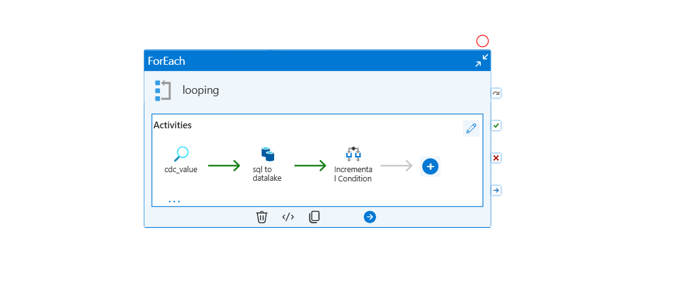
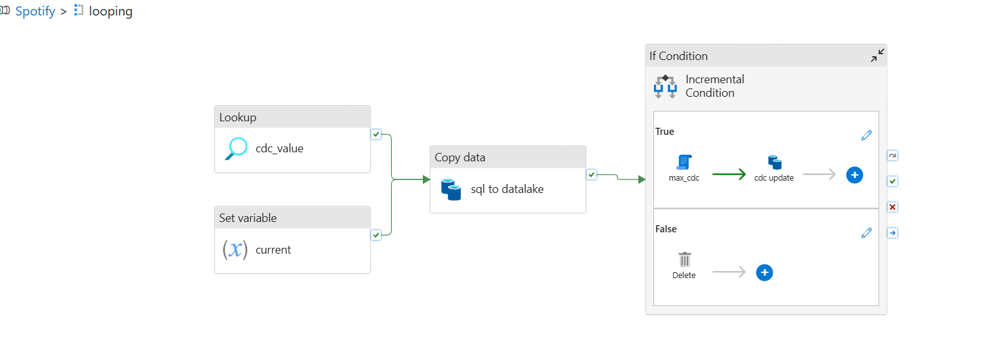

# Spotify End-to-End Azure Data Engineering Project

An end-to-end data engineering solution built using Microsoft Azure and Azure Databricks. This project demonstrates how to build a scalable, metadata-driven data pipeline with automated ingestion, incremental processing, data transformation, and analytics-ready data modelling.

The solution integrates Azure Data Factory, Azure SQL Database, Azure Data Lake Storage Gen2, and Azure Databricks to process data through the Bronze, Silver, and Gold layers.

## Project Architecture

```text
             Source Data
                  |
                  v
          Azure SQL Database
                  |
                  v
          Azure Data Factory
                  |
                  v
                 CDC 
                  |
                  v
       Azure Data Lake Storage
              Gen2
         (BRONZE LAYER)
                  |
             Auto Loader
                  |
                  v
            SILVER LAYER
       Cleansing & Transformation
         Data Quality Checks
           CDC Processing
                  |
                  v
             GOLD LAYER
       Business-Ready Data
        Dimensional Modelling
          Fact & Dimension
                Tables
                  |
                  v
           Analytics-Ready
               Data
```

## Technologies Used

| Technology | Purpose |
|---|---|
| Azure Data Factory | Data ingestion and orchestration |
| Azure SQL Database | Source database |
| Azure Data Lake Storage Gen2 | Cloud data storage |
| Azure Databricks | Data engineering and processing |
| Python | Programming |
| PySpark | Distributed data transformations |
| Apache Spark | Distributed processing |
| Delta Lake | Reliable data storage |
| Databricks Auto Loader | Incremental file ingestion |
| Spark Structured Streaming | Streaming data processing |
| Spark Declarative Pipelines | Managed data pipelines |
| Jinja | Metadata-driven code generation and templating |
| Unity Catalog | Data governance and management |
| Databricks Asset Bundles | Resource deployment and management |
| Git & GitHub | Version control |

## 1. Azure Data Factory – Data Ingestion

Azure Data Factory is used to orchestrate data movement from Azure SQL Database into Azure Data Lake Storage Gen2.

### Pipeline Implementation

The ingestion pipeline uses:

- Lookup activities to retrieve CDC or watermark values.
- Set Variable activities to initialize and maintain pipeline variables.
- ForEach activity to process multiple tables dynamically.
- Copy Data activity to transfer data from SQL Database to ADLS Gen2.
- If Condition activities to control incremental processing.
- CDC tracking to identify and process changed records.
- Watermark updates to maintain the latest processed value.

  
  

  


### Incremental Data Loading

Instead of repeatedly loading the complete source tables, the pipeline uses CDC/watermark-based processing to identify incremental changes and load the relevant records.

This reduces unnecessary data movement and supports efficient ingestion.

## 2. Metadata-Driven Pipeline

The project implements a metadata-driven ingestion approach to make pipeline execution reusable and configurable.

Instead of creating separate ingestion logic for every table, metadata is used to control the processing of multiple tables.

Key concepts:

- Centralized metadata-driven configuration.
- Dynamic table processing using ForEach.
- Reusable pipeline activities.
- Parameterized ingestion logic.
- Dynamic source and destination handling.

This approach improves maintainability and reduces repetitive pipeline development.

## 3. Jinja – Metadata-Driven Development

Jinja templates are used to support the metadata-driven implementation.

Jinja helps generate reusable configurations and code dynamically based on metadata rather than manually maintaining repetitive definitions.

Benefits:

- Reusable templates.
- Reduced code duplication.
- Dynamic configuration generation.
- Easier maintenance when adding or modifying tables.

## 4. Azure Data Lake Storage Gen2

ADLS Gen2 acts as the central storage layer between ingestion and Databricks processing.

It stores the data ingested by Azure Data Factory and provides the input for downstream processing.

## 5. Azure Databricks – Medallion Architecture

The Databricks implementation follows the Medallion Architecture, dividing data processing into three layers.

### Bronze Layer – Raw Data

- Ingests raw files from ADLS Gen2.
- Uses Databricks Auto Loader for incremental file ingestion.
- Stores raw data in Delta tables.
- Maintains the initial representation of source data.

### Silver Layer – Cleansed and Transformed Data

- Performs data cleansing using PySpark.
- Handles null values and invalid records.
- Implements data quality expectations.
- Applies transformations to prepare data for downstream processing.
- Uses streaming and CDC processing where required.

### Gold Layer – Business-Ready Data

- Creates refined, analytics-ready datasets.
- Implements dimensional modelling.
- Organizes data into fact and dimension tables.
- Supports downstream analytical use cases.

## 6. Incremental Processing and Change Data Capture

The project uses incremental data processing techniques across the ingestion and transformation layers.

Implementations include:

- CDC/watermark-based ingestion in Azure Data Factory.
- Auto Loader for incremental file ingestion.
- Spark Structured Streaming.
- Delta Lake-based change processing.
- Auto CDC for handling inserts, updates, and deletes in downstream tables.

These techniques help process new and changed records without repeatedly processing the entire dataset.

## 7. Data Quality and Governance

Data quality checks are implemented to improve the reliability of processed data.

Examples include:

- Validating required columns.
- Checking for null values.
- Applying data quality expectations.
- Handling invalid records according to configured rules.

Unity Catalog is used for data governance and management.

## 8. Dimensional Modelling

The Gold layer organizes processed data using dimensional modelling concepts.

- Fact tables represent measurable business events.
- Dimension tables provide descriptive attributes.
- Structured datasets support analytical queries.

## 9. Databricks Asset Bundles

Databricks Asset Bundles are used to organize and deploy Databricks resources across development and production targets.

Validate the development bundle:

```bash
databricks bundle validate -t dev
```

Deploy to development:

```bash
databricks bundle deploy -t dev
```

Deploy to production:

```bash
databricks bundle deploy -t prod
```

## Repository Structure

```text
Spotify-Azure-Project-DE/
│
├── Azure-Data-Factory/
│   ├── dataset/
│   ├── factory/
│   ├── linkedService/
│   └── pipeline/
│
├── Spotify-Databricks/
│   ├── jinja/
│   ├── resources/
│   ├── src/
│   ├── utils/
│   ├── databricks.yml
│   ├── pyproject.toml
│   ├── .gitignore
│   └── README.md
│
└── README.md
```

## Project Outcomes and Learning

Through this project, I gained hands-on experience with:

- Building end-to-end Azure data engineering pipelines.
- Developing metadata-driven ingestion workflows.
- Implementing incremental data loading using CDC and watermarks.
- Working with Azure Data Factory and ADLS Gen2.
- Developing PySpark transformations in Azure Databricks.
- Implementing the Bronze, Silver, and Gold architecture.
- Using Auto Loader and Spark Structured Streaming.
- Implementing CDC and Auto CDC processing.
- Creating reusable Jinja templates.
- Applying data quality checks.
- Working with Unity Catalog and dimensional modelling.
- Managing Databricks resources using Asset Bundles.
- Maintaining project code using Git and GitHub.

## Future Enhancement

- Integrate Azure Logic Apps with Azure Data Factory for additional workflow automation and notifications.
